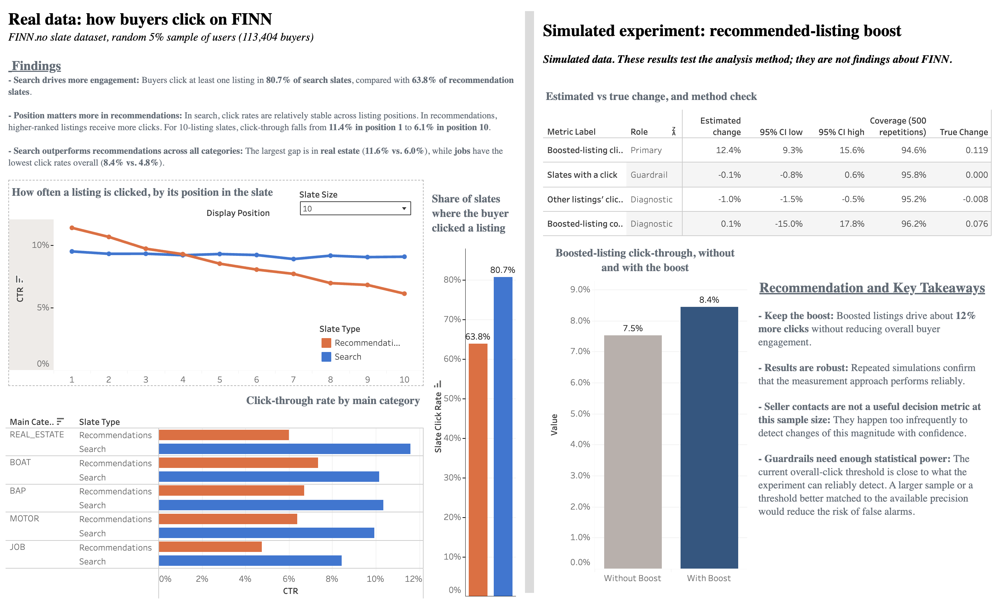

# FINN Marketplace Analytics

Analysis of buyer engagement on FINN.no, a simulated A/B test for promoted listings, and recommendation models evaluated on real clicks. Built with **Python, Snowflake, dbt, Tableau, ALS and LightGBM**.

**[Interactive Tableau dashboard](https://public.tableau.com/app/profile/mansi.gupta7450/viz/FINNMarketplaceAnalyticsBuyerEngagementABTesting/ClickstatsABtest)** · **[Full-size screenshot](https://github.com/mansigupta101/finn-marketplace-analytics/blob/main/Tableau_Dashboard.png)**

## Key findings

### 1. Buyer engagement · Real data

Using a 5% sample of the FINN.no Slates Dataset (**113,404 buyers; 1.86 million slates**):

- **80.7%** of search-result slates received a click, compared with **63.8%** of recommendation slates.
- Click rates across positions were almost flat in five-listing search slates, but declined noticeably down recommendation slates. Observed position differences also reflect ranking effects.

[Analysis notebook](analysis/real_data_findings.ipynb) · [Engagement charts](analysis/figures/search_vs_recs_click_rate.png) · [Position analysis](analysis/figures/position_ctr.png)

### 2. Promoted listings · Simulated A/B test

A buyer-randomised experiment modelled the impact of moving a paid listing to the top of recommendations.

- Boosted listings gained **12.4%** in click-through (95% CI: +9.3% to +15.6%).
- The share of recommendation slates with a click changed by **−0.09% relative** (95% CI: −0.77% to +0.60%).
- The confidence-interval method passed validation against known simulated effects.

**These are simulation results, not observed effects of FINN's product.**

[Experiment protocol](docs/ab_test_protocol.md) · [Full results](analysis/results/experiment_report.md)

### 3. Recommendation models · Real clicks, offline evaluation

An **ALS candidate retriever + LightGBM ranker** predicts a buyer's next clicked listing from their earlier interactions.

| Recommendation method | Hit@10 |
|---|---:|
| Global popularity | 0.38% |
| Category popularity | 0.47% |
| ALS | 4.76% |
| **ALS + LightGBM** | **5.36%** |

The two-stage model improved hit@10 by **0.60 percentage points** over ALS (95% CI: 0.41–0.78). This supports **testing the model live**, not deploying it based on offline metrics alone.

[Model evaluation](analysis/recommender_results.ipynb) · [Recommendation methodology](docs/recommendation.md)

## Data pipeline

`FINN.no slates → Python ingestion → Snowflake → dbt models → Tableau / analysis / recommendation scoring`

| Component | Code / configuration |
|---|---|
| Data extraction and loading | [`pipeline/load_finn_data.py`](pipeline/load_finn_data.py) |
| Snowflake setup | [`snowflake/setup.sql`](snowflake/setup.sql) |
| dbt transformations and tests | [`dbt_project/`](dbt_project/) |
| Environment and dbt connections | [`.env.example`](.env.example) · [`profiles.yml.example`](dbt_project/profiles.yml.example) |
| Experiment and recommender | [`pipeline/`](pipeline/) · [`recommender/`](recommender/) · [`analysis/`](analysis/) |

## Running the project

1. Create the Snowflake objects using [`setup.sql`](snowflake/setup.sql), obtain a Snowflake programmatic access token, then configure the connection using the [environment template](.env.example) and [dbt profile](dbt_project/profiles.yml.example).
2. Install dependencies from [`requirements.txt`](requirements.txt).
3. Run the [data loader](pipeline/load_finn_data.py) (`download`, `extract`, `load`), then run `dbt build --profiles-dir .` from `dbt_project/`.
4. Use the [engagement notebook](analysis/real_data_findings.ipynb), [A/B test script](pipeline/simulate_boost.py), or [recommender pipeline](analysis/recommender_pipeline.ipynb) for each analysis. Run tests with `python -m pytest analysis pipeline recommender`.

## Data source and scope

Dataset: [FINN.no Slates Dataset](https://github.com/finn-no/recsys_slates_dataset) (Eide et al., RecSys 2021). The data is an anonymised 30-day snapshot of exposures and clicks, without interaction timestamps, contact outcomes or completed transactions. The A/B test uses **simulated outcomes**; recommender results are **offline** and subject to historical exposure bias.
